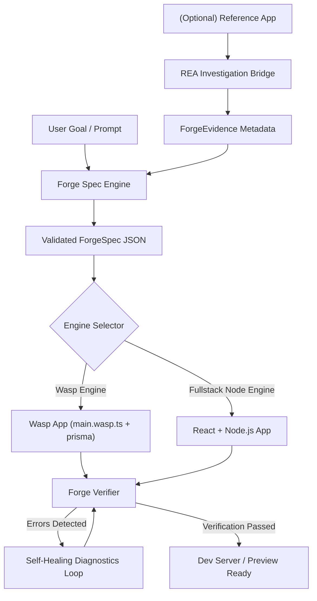

# Agent App Forge — Integration Plan

## 1. Upstream Dependency Management
- **No In-Place Modification:** The upstream repositories `wasp/` and `rea/` remain pristine, read-only reference dependencies.
- **Loose Coupling:**
  - REA is integrated as an optional subprocess or MCP bridge client. If REA tools (`rea-agents`) are missing or unsupported on the current platform, Agent App Forge continues uninterrupted with native heuristic analyzers.
  - Wasp is integrated via template generation and CLI invocation (`wasp compile`, `wasp start`). When running on platforms without native Wasp binaries (e.g. native Windows without WSL), the Forge automatically scaffolds a compatible, standard Full-Stack TypeScript engine while generating valid Wasp spec files for export.

---

## 2. Phase-by-Phase Integration Strategy

### Milestone 1: Specification & Schema Protocol
- Define TypeScript schemas for `ForgeSpec`, `EntityModel`, `Operation`, and `Evidence`.
- Provide bidirectional conversion between `ForgeSpec` and Wasp's `AppSpec`.

### Milestone 2: Code Synthesis Engines
- Implement template emission using TypeScript and ES template interpolations.
- Implement storage models (Prisma schema + SQLite database with initial migrations/seeding).

### Milestone 3: MCP Server & CLI Endpoints
- Implement MCP Server conforming to Model Context Protocol specification.
- Expose actionable tools with JSON schemas.
- Implement companion CLI `forge` with commands:
  - `forge init <appName>`
  - `forge generate --spec <path>`
  - `forge test --dir <path>`
  - `forge run --dir <path>`

### Milestone 4: Diagnostic Self-Repair Loop
- Parse stderr/stdout from TypeScript compiler and process runners.
- Match known failure patterns (missing imports, port conflicts, schema mismatches).
- Compute targeted patch diffs and re-verify.
