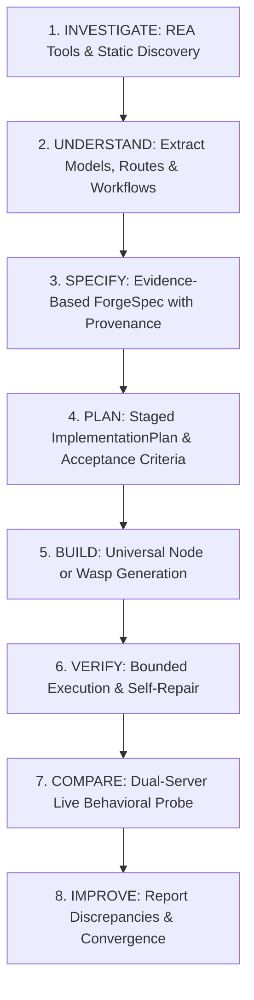

# Agent App Forge — Recreation Workflow Specification

**Version:** 1.0.0 (Phase 13)  
**Status:** Implemented & Verified (73/73 Tests Passing)  
**Target Environments:** Agent-agnostic (Terminal CLI, MCP Server, Antigravity, Claude Code, Cursor, Windsurf, Roo Code, Cline, Codex, Gemini CLI)

---

## 1. Overview & Vision

Agent App Forge extends conventional prompt-to-app code generation into a full **software recreation and reverse engineering system**.

Users and coding agents can:
1. Provide an **authorized reference target** (source repository, SQLite database, binary fixture, or directory) or a **natural language description** of desired software features.
2. Direct Forge to autonomously execute an 8-stage recreation loop:
   $$\text{INVESTIGATE} \longrightarrow \text{UNDERSTAND} \longrightarrow \text{SPECIFY} \longrightarrow \text{PLAN} \longrightarrow \text{BUILD} \longrightarrow \text{VERIFY} \longrightarrow \text{COMPARE} \longrightarrow \text{IMPROVE}$$
3. Produce a standalone, full-stack application with persistent storage, responsive client UI, automated unit tests, and acceptance workflows.

---

## 2. Supported Recreation Modes

| Mode | Trigger Condition | Primary Input | Output Characteristics |
|---|---|---|---|
| **`reference_driven`** | Target path specified (`--target <path>`) pointing to valid source, SQLite database, or binary. | Authorized filesystem path + user intent prompt | Grounded strictly in observed evidence. High confidence score. Capabilities tagged `observed`. |
| **`feature_driven`** | Natural language description without target path. | Prompt describing specific software or domain features (e.g., "Recreate document editor"). | Inferred domain models (e.g. Document & Revision) with explicit heuristic rationale. Confidence score reflects inferred state. |
| **`greenfield`** | Standard new application creation prompt. | Prompt describing a novel application from scratch. | Clean specification synthesized from user requirements without reference anchoring. |

---

## 3. The 8-Stage Recreation Lifecycle



### Stage 1: INVESTIGATE
- Invokes real upstream REA MCP tools (e.g., `inspect_sqlite_database`, `inspect_artifact`) via collision-safe delegators (`rea_*` and `forge_rea_tool`).
- Computes SHA-256 digests and extracts structural signatures (schema definitions, tables, columns, HTTP route endpoints).
- When target is a SQLite database, discovers exact table schemas and row counts via `node:sqlite`.

### Stage 2: UNDERSTAND
- Synthesizes entities, models, relations, and operations from extracted evidence.
- Identifies observable application workflows (e.g., document creation, autosave, multi-format export).
- Maps domain capabilities: rich-text editing, persistent SQLite storage, WAL mode, debounced autosave.

### Stage 3: SPECIFY
- Generates a strictly validated `ForgeSpec` (`forgespec.json`) with fine-grained provenance tagging (`observed`, `inferred`, `user_requested`, `unknown`).
- Includes a formal `coverageAssessment` containing workflow counts and confidence metrics.

### Stage 4: PLAN
- Generates a machine-readable `ImplementationPlan` (`implementation-plan.json`) containing:
  - Architecture breakdown (frontend, backend, storage, export pipelines).
  - Staged implementation tasks with explicit target files and provenance.
  - Acceptance criteria derived from observed workflows.
  - Known unknowns and toolchain limitations.

### Stage 5: BUILD
- Selects the optimal generation engine (`fullstack-node` or `wasp`).
- Emits clean, zero-dependency, full-stack application files:
  - `server.js`: Node HTTP REST server with persistent SQLite storage and export routes.
  - `public/index.html`: Modern responsive application canvas.
  - `public/style.css`: Clean responsive design.
  - `public/app.js`: Client application logic with debounced autosave and reactive state.
  - `test.js`: Automated self-verification tests.
  - `workflow.test.js`: End-to-end observable workflow acceptance suite.
  - `README.md`: Clear launch instructions.

### Stage 6: VERIFY
- Runs `ForgeVerifier`:
  - Validates package structure and file presence.
  - Validates SQLite storage presence (`app.db`).
  - Executes bounded self-verification tests (`test.js`) with 10s timeout protection.
  - Applies automated self-repair if storage or schema errors are encountered.

### Stage 7: COMPARE
- Spawns the generated application and optional reference target on distinct local ports.
- Probes live endpoints:
  - `GET /api/health`: Validates storage health and metadata.
  - `POST /api/documents`: Validates record creation and ID generation.
  - `PATCH /api/documents/:id`: Validates debounced autosave and word counts.
  - `GET /api/documents/:id/export`: Validates multi-format export fidelity (Markdown, HTML, Plain Text, JSON).
- Emits a structured `ComparisonReport` with feature statuses (`pass`, `partial`, `fail`, `blocked`).

### Stage 8: IMPROVE
- Records discrepancies between reference behavior and generated implementation.
- Suggests targeted refinement recommendations if behavioral gaps are detected.

---

## 4. CLI Usage & Flags

```bash
# Feature-driven recreation
node bin/forge.js recreate "Recreate document editor with rich-text editing, autosave, and export" --output ./my-doc-editor

# Reference-driven recreation against local reference app
node bin/forge.js recreate "Recreate reference application" --target ./fixtures/reference-document-app --output ./recreated-doc-app

# Generate implementation plan only without building
node bin/forge.js recreate "Recreate Microsoft Word web editor" --plan-only --json

# Recreate without behavioral comparison
node bin/forge.js recreate "Recreate task tracker" --no-compare
```

### Available CLI Flags
- `--target <path>`: Path to reference target software, database, or binary.
- `--output <dir>`: Directory where the recreated application is generated.
- `--engine <name>`: Target engine (`fullstack-node` or `wasp`). Defaults to platform-appropriate engine.
- `--plan-only`: Generate investigation, specification, and implementation plan without building code.
- `--no-compare`: Skip live server behavioral comparison.
- `--json`: Output full structured JSON payload for AI coding agent consumption.

---

## 5. MCP Tool: `forge_recreate_app`

Agent App Forge exposes the complete recreation workflow through the Model Context Protocol:

```json
{
  "name": "forge_recreate_app",
  "description": "Investigate reference software or natural language requirements, create an evidence-based specification and implementation plan, generate an independent application, verify it, and compare its behavior.",
  "parameters": {
    "type": "object",
    "properties": {
      "prompt": { "type": "string", "description": "Natural language request describing target software or features" },
      "targetPath": { "type": "string", "description": "Optional filesystem path to reference code, database, or binary" },
      "outputDirectory": { "type": "string", "description": "Output directory for the recreated application" },
      "targetEngine": { "type": "string", "enum": ["fullstack-node", "wasp"] },
      "planOnly": { "type": "boolean", "description": "Stop after generating plan without writing code" },
      "compare": { "type": "boolean", "description": "Run live server behavioral comparison against reference" }
    },
    "required": ["prompt"]
  }
}
```
