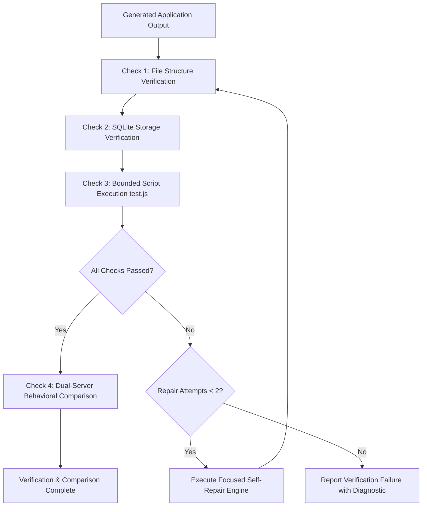

# Agent App Forge — Verification & Self-Repair Loop

**Standard:** Bounded Execution, Automated Self-Repair, Behavioral Parity  
**Modules:** `src/verifier/verifier.ts`, `src/recreation/comparator.ts`  
**Status:** Implemented & Formally Verified (Passing Fault-Injection Suite)  

---

## 1. Multi-Stage Verification Pipeline

The verification loop ensures that any generated application meets strict criteria for structure, storage, bounded execution, and behavioral parity before being marked as successful.

---

## 2. Verification Checks

### Check 1: File Structure Verification
- Checks for presence of `package.json`, `server.js`, and entry point files.
- Classifies missing files as `MISSING_FILE`.

### Check 2: Storage Verification
- Inspects SQLite database file (`app.db`).
- Verifies database presence and WAL journal mode.
- If missing, classifies issue as `MISSING_STORAGE`.

### Check 3: Bounded Script Execution (`test.js`)
- Runs `node test.js` in a child process with a hard **10-second timeout**.
- Prevents infinite loops or hanging processes from blocking the agent.
- Classifies failures into discrete error taxonomies:
  - `TIMEOUT`: Execution exceeded 10 seconds.
  - `SYNTAX_ERROR`: JavaScript syntax error.
  - `MISSING_STORAGE`: SQLite table missing error.
  - `TEST_FAILURE`: Assertion error.

---

## 3. Focused Self-Repair Engine

When `runCheckPipeline()` detects recoverable errors, `attemptFocusedRepair()` automatically remediates the failure without human intervention:

### Domain-Aware Schema Repair
The repair engine reads `forgespec.json` and inspects `server.js` to determine the target domain:
- **Document Studio (`document-editor`):**
  - Creates `app.db` with WAL mode enabled.
  - Creates `documents` table (`id`, `title`, `content`, `format`, `wordCount`, `isArchived`, `createdAt`, `updatedAt`).
  - Creates `revisions` table (`id`, `documentId`, `contentSnapshot`, `summary`, `savedAt`).
  - Injects default starter document if empty.
  - Logs: `Initialized SQLite database schema in app.db (documents & revisions)`.
- **Standard Applications (`tasks`):**
  - Creates `app.db` with WAL mode.
  - Creates `tasks` table (`id`, `title`, `isDone`, `createdAt`).
  - Injects starter task record.
  - Logs: `Initialized SQLite database schema in app.db`.

### Bounded Repair Iterations
Self-repair is strictly bounded to a maximum of **2 iterations**. If the error persists after 2 repair attempts, the verifier stops and returns an honest diagnostic report with all captured standard error streams.

---

## 4. Behavioral Comparison & Probing

The `RecreationComparator` verifies that the running application conforms to observable behavior:

1. **Ephemeral Port Allocation:** Selects high-range unused TCP ports.
2. **Process Spawning:** Launches `node server.js` with `NODE_ENV: "development"`.
3. **Socket Binding Grace Period:** Waits 800ms to guarantee port binding on Windows.
4. **Endpoint Probing:**
   - Probes `GET /api/health` to confirm HTTP server responsiveness and database connection.
   - Probes domain workflows (e.g., `POST /api/documents`, `PATCH /api/documents/:id`, `GET /api/documents/:id/export`).
5. **Deterministic Cleanup:** Guarantees that child processes are cleanly killed via `child.kill()`, with zero leaked sockets.

---

## 5. Fault-Injection Test Verification

The verification and self-repair engine is tested against deliberate fault injections in `tests/verifier.test.ts` and `tests/recreationWorkflow.integration.test.ts`:
- **Fault 1:** Non-existent project directory $\longrightarrow$ Detected as `MISSING_FILE`.
- **Fault 2:** Missing `package.json` $\longrightarrow$ Detected as `MISSING_FILE`.
- **Fault 3:** Deleted `app.db` $\longrightarrow$ Detected as `MISSING_STORAGE`, automatically repaired, and confirmed passing on iteration 2.
- **Fault 4:** Hanging script with `while(true)` $\longrightarrow$ Detected as `TIMEOUT` and aborted after 10s.
- **Fault 5:** Cold process termination and restart $\longrightarrow$ Verified data persistence across process death.
