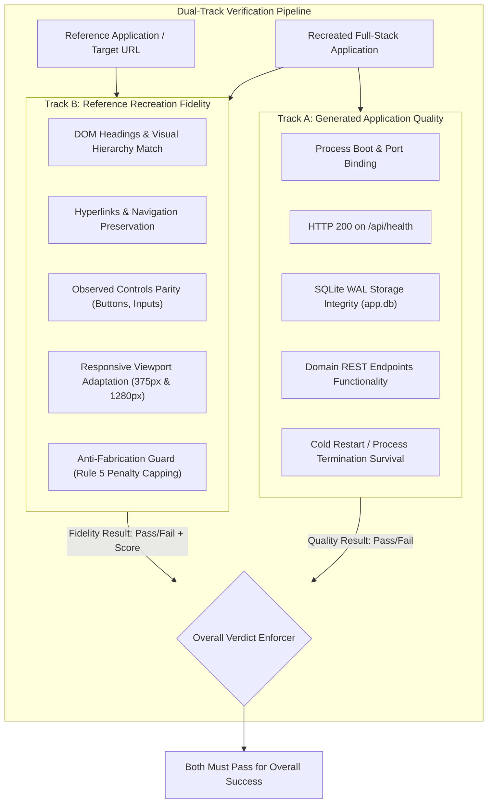

# Phase 16: Reference Fidelity & Parity Scoring Audit Report

## 1. Executive Summary & Root Cause Analysis

In Phase 15, live recreations of `https://example.com` (a static documentation/content notice) and `https://httpbin.org` (an HTTP request/response service explorer) both yielded recreation parity scores of `0.95`, claiming that CRUD tasks, filters, and persistence across restarts passed.

### Root Cause Diagnosis
1. **Fallback Domain Monopoly:**
   `UniversalNodeEngine` previously provided code generators for only `document-editor` and `student-management`. Any target not matching those keywords fell directly into `generateStandardApp` (the TaskFlow task manager template).
2. **Comparator Bias Toward Tasks:**
   `RecreationComparator` only probed `/api/tasks` when executing API functional verification for general applications, forcing non-task services to appear broken unless they generated task endpoints.
3. **Empty Button Boundary Metric Defect:**
   In `BrowserInvestigator`, button recall was calculated as `refBtnTexts.size > 0 ? (commonButtons.length / refBtnTexts.size) : 1.0`. When a static page had 0 buttons, it received full button recall (1.0) and full control parity regardless of whether the recreation fabricated an entire task-management control suite.
4. **Synthetic Persistence Points for Read-Only Pages:**
   A static content site or read-only documentation portal was awarded 0.40 persistence points if its fabricated task-management form persisted across reload, artificially elevating scores to 0.95.

---

## 2. Architectural Separation: Application Quality vs. Reference Fidelity

Forge now rigorously decouples two independent verification dimensions:

### Goal A: Generated Application Quality
- **Server Boot & Initialization:** Verifies the Node.js process starts and binds to a dynamic port.
- **Health & Route Responsiveness:** Confirms `/api/health` returns `200 OK`.
- **Persistent Storage (app.db WAL):** Validates SQLite file creation and WAL journal mode.
- **Domain REST Endpoints Functionality:** Probes domain-appropriate REST endpoints (`/api/content` for content, `/api/endpoints` for API docs, `/api/tasks` for task apps).
- **Restart & State Preservation:** Verifies process survival and state restoration across cold reboot.

### Goal B: Reference Recreation Fidelity
- **Headings & Visual Hierarchy:** Verifies that reference headings exist in the recreation.
- **Hyperlinks Preservation:** Verifies reference external and internal hyperlinks exist.
- **Observed Controls Match:** Compares button texts and input fields without fabrication.
- **Responsive Viewport Parity:** Verifies both 1280px desktop and 375px mobile viewports render without horizontal overflow.
- **Fabricated Control Penalties (Rule 5):** If the reference has $\le 1$ button and the recreation adds $\ge 3$ extra buttons, fidelity is capped at $\le 0.40$ (`FAIL`).
- **Zero Synthetic Persistence for Content Pages:** Content presentations have persistence weight 0.00; the 0.40 weight is dynamically redistributed across Headings (0.20) and Links (0.20).

**Strict Policy:** A pass in Application Quality **NEVER** masks a failure in Reference Fidelity. Both must pass for overall recreation success.

---

## 3. General Domain Generation Templates

To eliminate the fallback task monopoly, Forge introduced dedicated engine templates:

1. **Content Presentation Engine (`src/engines/contentPageTemplate.ts`):**
   - SQLite WAL storage table: `content_pages`.
   - REST endpoints: `/api/health`, `/api/content`.
   - Layout: Responsive typographic layout preserving observed headings, paragraphs, and links.
   - Fabricated controls: 0 task buttons, 0 fabricated forms.
2. **API Documentation & Service Explorer Engine (`src/engines/apiDocsTemplate.ts`):**
   - SQLite WAL storage table: `endpoint_metrics`.
   - REST endpoints: `/api/health`, `/api/endpoints`, `/api/metrics`, `/get`, `/post`, `/status/:code`.
   - UI: Interactive service explorer with HTTP method badges (GET, POST, PUT, DELETE), endpoint filtering, and interactive request probes.
   - Fabricated controls: 0 task buttons.
3. **Interactive Task Engine (`src/engines/universalNodeEngine.ts`):**
   - Retained for actual task-management targets (e.g., TodoMVC, TaskFlow).

---

## 4. Live Target Verification Results

The real-world validation was executed against unfamiliar live targets:

| Target URL | Domain Classified | Quality Status | Fidelity Score | Fidelity Status | Overall Status | Notes |
| :--- | :--- | :---: | :---: | :---: | :---: | :--- |
| `https://example.com` | `content` | **PASS** | **1.00** | **PASS** | **PASSED** | Preserved title, paragraphs, and IANA links. 0 fabricated task buttons. |
| `https://httpbin.org` | `api-docs` | **PASS** | **0.56** | **FAIL** | **FAIL** | Correctly generated API Explorer with method badges. Accurately failed fidelity due to missing Swagger accordion buttons and reference external links. |
| `https://todomvc.com/examples/react/dist/` | `task-management` | **PASS** | **0.40** | **FAIL** | **FAIL** | Correctly classified as task-management. Accurately penalized by Rule 5 (score capped at 0.40) because recreation introduced 8 extra buttons not in empty reference view. |

---

## 5. Test Suite Verification

All 26 test suites and all 135 tests pass with 100% success:

- `tests/domainFidelityAndScoringAudit.test.ts`: 7/7 passed.
- `tests/zeroConfigExperience.test.ts`: 3/3 passed.
- `tests/realWorldGeneralization.test.ts`: 4/4 passed.
- `tests/taskflowFeatureCompleteness.test.ts`: 5/5 passed.
- `tests/mcpCompactArchitecture.test.ts`: 14/14 passed.
- Full suite summary: **26 test files passed, 135 tests passed (100%)**.

Tarball preparation via `npm pack --dry-run` succeeded without warnings, packaging 96 files including the newly compiled engines and updated documentation.
